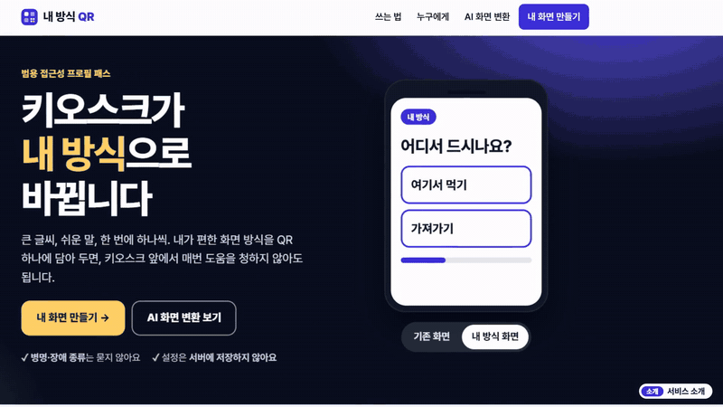

# 내 방식 QR

> 키오스크가 **내 방식**으로 바뀝니다 — 큰 글씨 · 쉬운 말 · 한 번에 하나씩

2026 AI 라이프 솔루션 챌린지(KEIT) 출품 프로토타입입니다.
화면 선호(글자 크기·쉬운 말·고대비·음성 안내·한 단계씩·시간 연장)를 QR 하나에 담아, 모의 키오스크가 그 방식으로 바뀌는 웹 서비스입니다.



**체험하기: https://my-way-qr.onrender.com**
(무료 호스팅이라 한동안 접속이 없으면 첫 접속에 20~30초 걸릴 수 있습니다.)

## 무엇을 하나요
1. **말하기** — 원하는 화면 방식을 말하거나 적습니다. 음성 입력과 자주 쓰는 말 버튼도 있습니다.
2. **확인하기** — AI가 6가지 설정으로 바꿔 주고, 미리 보면서 직접 고칩니다.
3. **내 QR** — 설정이 담긴 QR이 만들어지고, 휴대폰으로 찍으면 같은 설정으로 열립니다.
4. **AI 화면 변환** — 처음 보는 키오스크의 질문·선택지를 붙여넣으면 AI가 단계로 나누고 쉬운 말로 바꿉니다. 직원 도움이 필요한 선택지(예: 현금 결제)는 따로 표시합니다.

## 안전하게 만들었습니다
- QR/URL에는 **화면 선호 설정만** 들어갑니다. 병명·장애 종류·이름은 묻지도, 저장하지도 않습니다.
- AI가 틀릴 수 있다는 전제로 설계했습니다. 변환 결과의 **가격·수량 숫자가 원문과 다르면 사용을 막고**, 결제 전에는 원문과 나란히 보여 줍니다.
- 입력한 문장은 AI 처리를 위해 외부 AI 서비스로 전송될 수 있습니다. 개인정보는 넣지 마세요. (음성 입력은 브라우저 회사의 서버로 전송될 수 있습니다.)
- 키오스크는 **시연용 모의 화면**입니다. 실제 결제·발급은 되지 않습니다.

## 실행
```powershell
python -m pip install --target .\libs -r requirements.txt   # 처음 한 번
.\run.ps1                                                   # http://localhost:8765
```
- 휴대폰으로 QR을 찍어 보려면 PC와 같은 Wi-Fi여야 합니다 (QR에는 PC의 LAN 주소가 들어갑니다).
- AI 기능: 이 폴더에 `.env`를 만들고 `ANTHROPIC_API_KEY=...`를 적습니다. 키가 없으면 규칙/사전 모드로 동작합니다. 키는 저장소에 올리지 않습니다(`.gitignore`).

## 구성
| 경로 | 설명 |
|---|---|
| `app/main.py` | FastAPI 서버. `/api/profile/parse`(말 → 설정), `/api/rewrite`(쉬운 말), `/api/transform`(화면 변환 + 숫자 검사), `/api/qr` |
| `app/static/index.html` | 소개 + 내 방식 만들기(말하기 → 확인 → QR) |
| `app/static/kiosk.html` | 모의 키오스크(기본 화면 vs 내 방식 화면) |
| `app/static/transform.html` | AI 화면 변환 |
| `app/scenarios.json` | 키오스크 시나리오(카페·민원·병원)와 쉬운 말 사전 |
| `docs/` | 사용 방법, 데모 GIF |

## 문서
- 사용 방법: [docs/usage-guide.md](docs/usage-guide.md)
- 배포 방법(Render): [DEPLOY.md](DEPLOY.md)

## 현재 상태와 한계
- AI 응답은 매번 조금씩 다릅니다. 숫자 검사에 걸리면 다시 변환해야 할 수 있습니다.
- 모의 키오스크 시나리오와 쉬운 말 사전은 직접 작성한 것입니다. 실제 키오스크와 연동되지 않습니다.
